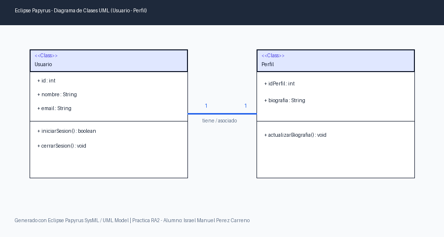

# Práctica RA2: Evaluación y Gestión de Entornos de Desarrollo

**Alumno:** Israel Manuel Pérez Carreño  
**Correo Electrónico:** israelmanuelperezcarreno@gmail.com  
**GitHub:** [israelmanuelperezcarreno-oss](https://github.com/israelmanuelperezcarreno-oss)  
**Repositorio Oficial:** [https://github.com/israelmanuelperezcarreno-oss/Practica_RA2](https://github.com/israelmanuelperezcarreno-oss/Practica_RA2)  
**Módulo Formativo:** Entornos de Desarrollo (Resultado de Aprendizaje 2)  
**Ciclo Formativo:** Desarrollo de Aplicaciones Multiplataforma / Web (DAM / DAW)

---

## 🎯 Objetivos de la Práctica
1. **Configuración, personalización y evaluación de IDEs:** Instalación, ajuste visual nativo, configuración de guardado automático (Save Actions) y gestión de actualizaciones de Eclipse.
2. **Gestión de Módulos y Herramientas CASE:** Integración del plugin Papyrus SysML 1.6 para modelado UML/SysML, gestión de instalación y desinstalación de plugins secundarios en Eclipse Marketplace.
3. **Control de Versiones Profesional (Git/GitHub):** Creación de repositorios, trabajo mediante ramas de características (`feature-uml`, `feature-python`, `feature-java-gui`), fusiones (`merges`) y sincronización con GitHub Desktop.
4. **Soporte Multilenguaje:** Demostración de las capacidades políglotas de Eclipse mediante el módulo PyDev y ejecución de scripts Python.
5. **Diseño de Interfaces Gráficas (WindowBuilder):** Construcción de aplicaciones visuales Swing con ventanas conectadas (`VentanaPrincipal` y `SegundaVentana`) y generación de ejecutables.
6. **Ejecución Cruzada y Comparativa de IDEs:** Validación de la portabilidad del código fuente ejecutando el proyecto en Visual Studio Code sin modificaciones, junto con una comparativa técnica profunda.

---

## 🛠️ Ejercicio 1: Herramientas CASE y Modelado UML (Papyrus)

### 📐 Diagrama de Clases UML Replicado en Papyrus
Se ha modelado la arquitectura orientada a objetos compuesta por dos clases interconectadas mediante una asociación dirigida:

1. **Clase `Usuario`:**
   - **Atributos:**
     - `+ id : int` (Identificador único del usuario)
     - `+ nombre : String` (Nombre completo del usuario)
     - `+ email : String` (Dirección de correo electrónico)
   - **Operaciones:**
     - `+ iniciarSesion() : boolean` (Verifica credenciales de acceso)
     - `+ cerrarSesion() : void` (Finaliza la sesión activa)
2. **Clase `Perfil`:**
   - **Atributos:**
     - `+ idPerfil : int` (Identificador único del perfil asociado)
     - `+ biografia : String` (Descripción personal del usuario)
   - **Operaciones:**
     - `+ actualizarBiografia() : void` (Modifica el contenido biográfico)
3. **Relación (Association):**
   - Una asociación directa entre `Usuario` y `Perfil` que modela la cardinalidad de pertenencia (*Un usuario tiene asociado un perfil*).

---

### 📚 Fundamentos Teóricos: Funciones de las Herramientas CASE

Las herramientas **CASE** (*Computer-Aided Software Engineering* o Ingeniería de Software Asistida por Computadora), como **Eclipse Papyrus**, proporcionan un entorno automatizado para gestionar todo el ciclo de vida del software (SDLC). A continuación se identifican y explican detalladamente sus funciones primordiales:

#### 1. Funciones para el Desarrollo de Código
- **Modelado Visual y Abstracción:** Permiten a los arquitectos e ingenieros diseñar sistemas complejos utilizando lenguajes formales estandarizados (UML 2.5, SysML 1.6), reduciendo la complejidad cognitiva antes de escribir una sola línea de código.
- **Generación Automática de Esqueletos de Código (*Forward Engineering*):** A partir de los diagramas de clases, paquetes e interfaces, la herramienta CASE genera automáticamente el código fuente base (en lenguajes como Java, C++ o Python), incluyendo la declaración de clases, propiedades con sus tipos de datos, visibilidades (`public`, `private`) y firmas completas de métodos.
- **Ingeniería Inversa (*Reverse Engineering*):** Capacidad de analizar código fuente existente para sintetizar de forma automatizada diagramas UML representativos de la arquitectura real implementada, facilitando el análisis de código legado (*legacy*).
- **Ingeniería de Ida y Vuelta (*Round-Trip Engineering*):** Mantiene una sincronización bidireccional continua entre el modelo visual y el código fuente. Modificaciones realizadas en el diagrama actualizan el código, y cambios realizados en el IDE se reflejan de inmediato en los diagramas.

#### 2. Funciones para la Prueba de Software (*Testing*)
- **Generación de Pruebas Basadas en Modelos (*Model-Based Testing - MBT*):** Las herramientas CASE utilizan diagramas dinámicos (diagramas de máquinas de estados, diagramas de secuencias y de actividades) para deducir rutas de ejecución críticas, condiciones límite y generar automáticamente casos de prueba de unidad e integración.
- **Trazabilidad Completa de Requisitos:** En entornos como SysML (integrado en Papyrus), los diagramas de requisitos permiten vincular cada necesidad del cliente con los componentes de diseño que los satisfacen (`«satisfy»`) y con los casos de prueba que los verifican (`«verify»`), garantizando que ningún requisito quede sin probar.
- **Validación Estática de Modelos y Detección Temprana de Errores:** Incorporan motores de validación de reglas (como OCL - *Object Constraint Language*) que detectan contradicciones lógicas, dependencias circulares o violaciones de patrones de diseño en fases tempranas, evitando que los errores arquitectónicos lleguen a la fase de codificación, donde su corrección resulta hasta 100 veces más costosa.

#### 3. Funciones para la Documentación del Sistema
- **Generación Automatizada de Especificaciones Técnicas:** A partir del repositorio central de modelos (XMI/EMF), la herramienta extrae información actualizada para producir memorias de diseño, diccionarios de datos y manuales de arquitectura en formatos estandarizados (PDF, HTML, DocBook, Markdown).
- **Lenguaje Visual Unificado y Estandarizado:** Al fundamentarse en estándares internacionales del OMG (*Object Management Group*), la documentación generada elimina la ambigüedad del lenguaje natural y sirve como medio de comunicación riguroso entre clientes, analistas, desarrolladores y evaluadores de calidad.
- **Historial de Versiones Arquitectónicas y Gobernanza:** Permite documentar la evolución del diseño técnico en consonancia con los sistemas de control de versiones (Git), facilitando auditorías de software y el cumplimiento de normativas de calidad (como ISO/IEC/IEEE 12207 o CMMI).
